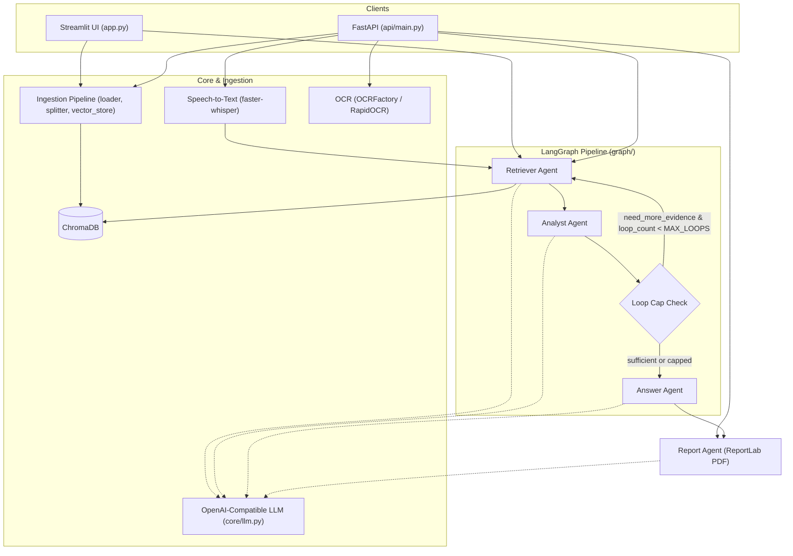
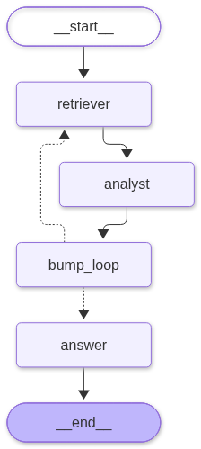

# Multi-Agent RAG Document QA System

A modular Retrieval-Augmented Generation (RAG) and document intelligence system orchestrated with LangGraph. It indexes PDF, DOCX, and TXT documents into ChromaDB, answers questions through a cyclic multi-agent pipeline (Retriever, Analyst, Answer), supports voice queries via local Whisper transcription, extracts text from images via OCR, and generates styled PDF reports.

---

## Overview

Single-pass RAG pipelines often struggle with multi-part or analytical questions when the initial retrieval misses key context. This system addresses that by pairing hybrid retrieval with an iterative evidence-evaluation loop:

- **Document Ingestion & Management:** Loads `.pdf`, `.docx`, and `.txt` files, splits them into overlapping chunks, enriches metadata (`doc_name`, `page_number`, `chunk_id`), and indexes them in ChromaDB. Supports per-document deletion and full store reset.
- **Cyclic Multi-Agent QA:** Coordinates a Retriever agent, a tool-calling Analyst agent, and an Answer agent in a bounded LangGraph loop (`MAX_LOOPS = 3`). If evidence is insufficient, the Analyst requests a targeted follow-up query; if the loop cap is reached, the Answer agent qualifies its response.
- **Voice Queries:** Transcribes uploaded audio locally using `faster-whisper` and routes the transcript through the RAG pipeline.
- **OCR Extraction:** Extracts text from uploaded images asynchronously via a factory-managed OCR engine (`RapidOCR`).
- **PDF Report Generation:** Uses a dedicated Report agent and `ReportLab` builder to produce formatted A4/Letter PDF reports from answers, analyses, and sources.
- **Dual Interfaces:** Exposes the pipeline through both a Streamlit web UI (`app.py`) and a FastAPI REST API (`api/main.py`).

---

## Architecture

### System Overview



### LangGraph Agent Workflow

The compiled LangGraph workflow rendered from `graph/workflow.py` (`graph/visualize.py`):



### Component Responsibilities

- **`core/`**: Shared configuration (`config.py`), cached `ChatOpenAI` initialization (`llm.py`), centralized prompt templates (`prompts.py`), local Whisper transcription (`speech.py`), and OCR abstraction (`ocr/`).
- **`ingestion/`**: Document loading (`loader.py`), recursive text splitting (`splitter.py`), ChromaDB vector operations (`vector_store.py`), and end-to-end indexing (`ingestion.py`).
- **`graph/`**: LangGraph `State` and `EvidenceItem` contract (`state.py`), graph nodes and conditional routing (`workflow.py`), pipeline entry point `run_pipeline()` (`runner.py`), and graph diagram exporter (`visualize.py`).
- **`agents/`**:
  - `retriever/`: Query rewriting, semantic search, optional BM25 keyword search, metadata filtering, CrossEncoder reranking, and character-budgeted context selection.
  - `analyst/`: Tool-calling agent (`create_agent`) equipped with `calculate_tool`, `extract_tables_tool`, `data_analysis`, `compare_documents`, and `request_more_evidence`.
  - `answer/`: Source formatting (`[S1]`, `[S2]`, ...), response generation, incomplete-evidence qualification, and inline citation resolution.
  - `report/`: Tool-calling PDF designer agent backed by `ReportBuilder` (`reportlab`).
- **`api/`**: FastAPI application (`main.py`), Pydantic request/response schemas (`schemas.py`), and modular routers (`documents.py`, `query.py`, `voice.py`, `report.py`, `ocr.py`).

---

## Tech Stack

| Category | Technologies | Role |
| :--- | :--- | :--- |
| **Language** | Python 3.13 | Core runtime |
| **Orchestration** | LangGraph, LangChain (`langchain`, `langchain-core`, `langchain-openai`, `langchain-community`) | Cyclic agent state graph, tool-calling agents, LLM & loader abstractions |
| **Vector Store & Embeddings** | ChromaDB (`langchain-chroma`), HuggingFace (`langchain-huggingface`, `sentence-transformers/all-MiniLM-L6-v2`) | Persistent vector storage and dense retrieval |
| **Reranking & Keyword Search** | `sentence-transformers` (`cross-encoder/ms-marco-MiniLM-L-6-v2`), `BM25Retriever` | Cross-encoder reranking and optional BM25 lexical search |
| **Document Parsing** | `PyPDFLoader`, `Docx2txtLoader`, `TextLoader`, `pdfplumber`, `python-docx` | Text and table extraction from PDF, DOCX, and TXT files |
| **Web UI & API** | Streamlit, FastAPI, Pydantic, Uvicorn | Interactive chat UI and REST API service |
| **Speech & OCR** | `faster-whisper`, `rapidocr`, Pillow | Local audio transcription and image text extraction |
| **PDF Generation** | `reportlab` | Styled multi-section PDF report generation |

---

## Project Structure

```text
Chat_System_With_Agents/
├── app.py                          # Streamlit web UI (upload, delete ingestion, chat)
├── CONTRACT.md                     # State, evidence item, and node contract rules
├── requirements.txt                # Pinned Python dependencies
├── .env                            # Environment configuration (not committed with secrets)
│
├── assets/
│   ├── agent_graph.mmd             # Mermaid source exported from LangGraph
│   └── agent_graph.png             # Rendered LangGraph workflow diagram
│
├── core/
│   ├── __init__.py
│   ├── config.py                   # Env vars, model names, loop/retriever limits, paths
│   ├── llm.py                      # Cached ChatOpenAI factory (get_llm)
│   ├── prompts.py                  # Centralized system and tool prompt templates
│   ├── speech.py                   # Local faster-whisper transcription and warm-up
│   └── ocr/
│       ├── __init__.py
│       ├── base.py                 # BaseOCR abstract interface
│       ├── rapid_ocr.py            # RapidOCR implementation
│       └── factory.py              # Cached OCRFactory
│
├── graph/
│   ├── __init__.py
│   ├── state.py                    # State, AnalystState, EvidenceItem, to_evidence_item()
│   ├── workflow.py                 # StateGraph nodes, bump_loop_count, after_analyst, build_graph()
│   ├── runner.py                   # Cached graph execution via run_pipeline()
│   └── visualize.py                # Renders agent_graph.png and agent_graph.mmd into assets/
│
├── ingestion/
│   ├── __init__.py
│   ├── loader.py                   # PDF, DOCX, TXT loading with 1-based page metadata
│   ├── splitter.py                 # RecursiveCharacterTextSplitter (1000 chars, 200 overlap)
│   ├── vector_store.py             # ChromaDB persistence, chunk IDs, search, delete, reset
│   └── ingestion.py                # ingest_documents() orchestration
│
├── agents/
│   ├── __init__.py
│   ├── retriever/
│   │   ├── retriever_agent.py      # retrieve() pipeline
│   │   └── tools/                  # query_rewriter, semantic_search, keyword_search,
│   │                               # metadata_filter, reranker, context_selector
│   ├── analyst/
│   │   ├── analyst_agent.py        # make_analyst_node() tool-calling agent
│   │   └── tools/                  # calculator, data_analysis, document_comparison,
│   │                               # evidence_request, table_extractor
│   ├── answer/
│   │   ├── answer_agent.py         # answer_question() synthesis
│   │   └── tools/                  # source_formatter, response_formatter, citation_formatter
│   └── report/
│       ├── report_agent.py         # generate_report() PDF designer agent
│       └── report_tools/           # report_builder, report_design, report_tools
│
├── api/
│   ├── __init__.py
│   ├── main.py                     # FastAPI app, lifespan warm-up, router registration
│   ├── schemas.py                  # Pydantic request/response models
│   └── routers/
│       ├── __init__.py
│       ├── documents.py            # POST/GET/DELETE /documents
│       ├── query.py                # POST /query
│       ├── voice.py                # POST /voice-query
│       ├── report.py               # POST /report
│       └── ocr.py                  # POST /ocr (async)
│
└── tests/
    ├── test_analyst_tools.py       # Unit tests for analyst tools
    ├── test_ocr.py                 # Unit tests for OCRFactory and RapidOCR
    ├── test_ocr_api.py             # FastAPI TestClient tests for POST /ocr
    ├── ocr_sample_test.py          # Parametrized sample image OCR test
    └── ocr_samples/                # Sample images for OCR testing
```

---

## Installation and Setup

### Prerequisites

- Python 3.13 (or compatible Python 3.11+ environment)
- An OpenAI-compatible API key (e.g., OpenRouter or OpenAI)

### 1. Create and Activate a Virtual Environment

```powershell
python -m venv .venv
.venv\Scripts\activate
```

### 2. Install Dependencies

```powershell
pip install -r requirements.txt
```

If running the FastAPI server or OCR API tests and `fastapi` is not yet installed in your environment:

```powershell
pip install "fastapi[standard]"
```

### 3. Configure Environment Variables

Create or update `.env` in the project root:

```env
OPENAI_API_KEY=your_api_key_here
OPENAI_BASE_URL=https://openrouter.ai/api/v1
OPENAI_MODEL=your_model_name_here
LLM_TEMPERATURE=0
OCR_ENGINE=rapidocr
```

Optional speech-to-text variables read by `core/speech.py`:

```env
WHISPER_MODEL=small
WHISPER_DEVICE=cpu
WHISPER_COMPUTE_TYPE=int8
MAX_AUDIO_SECONDS=120
```

---

## Usage

### Run the Streamlit Web UI

```powershell
streamlit run app.py
```

### Run the FastAPI Server

```powershell
uvicorn api.main:app --reload
```

### API Endpoints

| Method | Path | Description |
| :--- | :--- | :--- |
| `GET` | `/health` | Health check (`{"status": "ok"}`) |
| `POST` | `/documents` | Upload and index a `.pdf`, `.docx`, or `.txt` file (max 20 MB) |
| `GET` | `/documents` | List indexed document names |
| `DELETE` | `/documents/{document_name}` | Delete a document's chunks from ChromaDB and `uploads/` |
| `POST` | `/query` | Run the RAG pipeline (`{"question": "...", "chat_history": []}`) |
| `POST` | `/voice-query` | Transcribe an audio file (max 25 MB) and run the RAG pipeline |
| `POST` | `/report` | Generate and download a styled `report.pdf` |
| `POST` | `/ocr` | Async image upload (`.png`, `.jpg`, `.jpeg`, `.bmp`, `.tiff`, `.webp`) returning extracted text |

### Regenerate the Agent Graph Diagram

```powershell
python graph/visualize.py
```

Outputs `assets/agent_graph.png` and `assets/agent_graph.mmd`.

### Run Tests

```powershell
python -m pytest tests/
```

---

## Implementation Details

- **Evidence Contract (`CONTRACT.md`):** Only the retriever interacts with LangChain `Document` objects. Everything downstream uses normalized `EvidenceItem` dicts (`text`, `doc_name`, `page`, `chunk_id`, `score`) with 1-based page numbers (`None` if unknown).
- **Loop & Recursion Controls:**
  - The outer `retriever <-> analyst` loop is capped at `MAX_LOOPS = 3` (`core/config.py`). When reached with `need_more_evidence=True`, `bump_loop_count` sets `evidence_complete=False` so the Answer agent warns the user of partial evidence.
  - Inside `analyst_node`, the tool-calling agent has a separate `RECURSION_LIMIT = 12` to prevent runaway tool loops within a single turn.
- **Deterministic Chunk IDs & Deduplication:** `ingestion/vector_store.py` computes an 8-character MD5 hash (`source|page|start_index|content`) for each chunk and deduplicates retrieved chunks by `chunk_id` across retrieval loops.
- **Non-Blocking Async OCR:** `api/routers/ocr.py` reads uploaded image bytes asynchronously and runs `OCRFactory.create` and `extract_text` in worker threads via `asyncio.to_thread`.

---

## Limitations and Future Improvements

- **BM25 Activation:** `keyword_search.py` provides `build_bm25_retriever()`, but `retriever_node` in `graph/workflow.py` currently invokes `retrieve(query, chat_history=chat_history, llm=llm)` without passing a `bm25` instance, so only semantic search + CrossEncoder reranking runs by default.
- **API Dependency Packaging:** `requirements.txt` includes `uvicorn` and `httpx`, while `fastapi` / `python-multipart` (and `faster-whisper` / `rapidocr` / `reportlab` if not installed separately) should be pinned in `requirements.txt` for reproducible setups.
- **Planned / Ongoing Refactoring:**
  - Additional unit and integration tests for `graph/`, `ingestion/`, and the remaining API routers (`query`, `documents`, `voice`, `report`).
  - Migrating remaining procedural modules and tool helpers into structured classes where appropriate for extensibility and state encapsulation.
